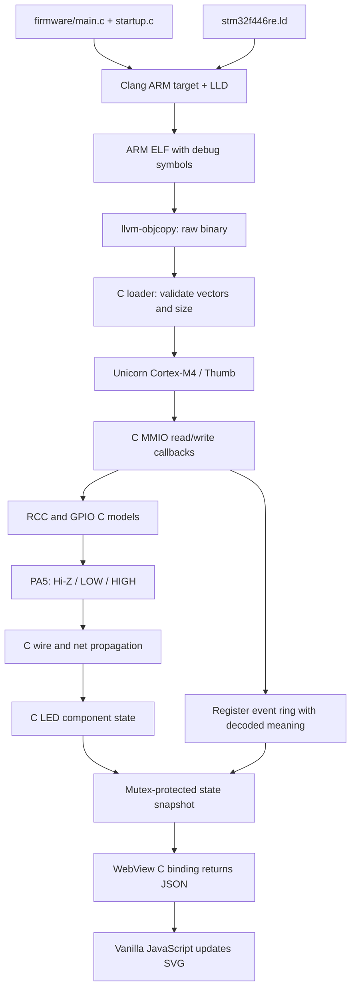
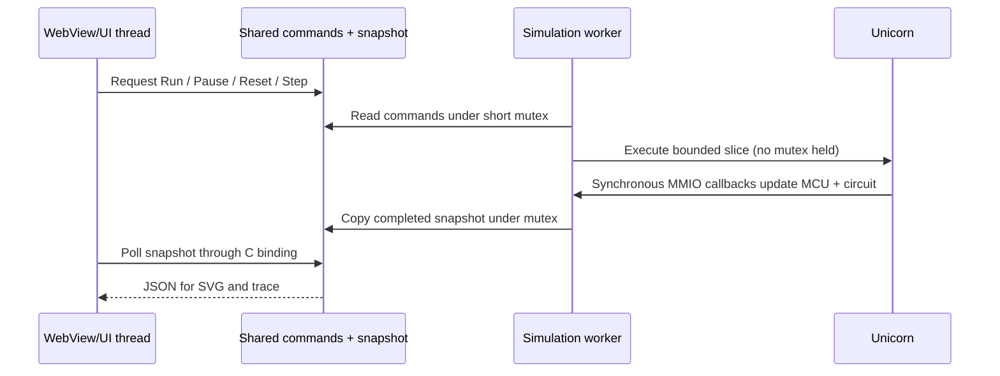

# STM32-Csim architecture

Three machines must stay distinct:

| Machine | Role |
| --- | --- |
| Host: Windows x86-64 or macOS ARM64 | Runs the native application, Unicorn and WebView |
| Simulated CPU: ARM Cortex-M4 | Executes compiled Thumb/Thumb-2 instructions |
| Simulated MCU: STM32F446RE | C models provide Flash, SRAM, RCC, GPIO and pins |

The firmware's `volatile uint32_t *` addresses belong only to Unicorn's guest
address space. Native C **never dereferences** a host pointer at `0x40023830`.
MMIO callbacks receive a numeric guest offset and call `device_access`.

## Modules

- `src/emulator/firmware.c`: bounded binary file load, explicit little-endian vector
  decoding, stack/reset validation. No ELF parser is needed at runtime.
- `src/emulator/cpu.c`: Unicorn lifetime, Cortex-M4 selection, Flash/SRAM mapping,
  MMIO callbacks, bounded stepping and errors. No GUI dependency.
- `src/stm32/f446/`: register constants, RCC/GPIO state, access rules, pin updates,
  and reusable register events containing operation/address/value/before/after.
- `src/circuit/`: component, pin, wire, net and signal types. C resolves the fixed
  resistor/LED circuit on register changes. JavaScript does not solve it.
- `src/app/platform.c`: the only host-specific C implementation. Windows threads
  and mutexes, POSIX threads on macOS, executable-relative asset paths.
- `src/app/webview_bridge.c`: worker ownership, command queue, snapshots, bounded
  JSON output, asset loading and C WebView bindings.
- `web/`: HTML/CSS/SVG presentation with a read-only source textarea. UI button
  commands and render-only state handling; no firmware parser or emulated GPIO.

## Scheduling and ownership

The worker exclusively owns `cpu_t`, its Unicorn handle and mutable device/circuit.
The UI exclusively owns WebView. It polls at 60 ms with at most one outstanding
request. No `webview_eval` or other UI API runs on the worker, so worker-to-UI dispatch
and queued callback lifetime hazards are avoided. Each binding callback runs on
the UI thread and returns immediately after copying state or recording a command.

Pause takes effect at a slice boundary. Step pauses and requests one instruction;
it is not a C source line. Reset pauses, discards pending steps, recreates CPU/RAM,
restores peripheral reset values, and leaves the new CPU at Reset_Handler. Run
resumes from its PC with the Thumb bit supplied to Unicorn. Close asks the worker
to stop, joins it, then destroys WebView and frees firmware. No UI object outlives
its owner or retains a pointer into mutable emulator state.

## Dependencies and portability

The application and firmware are C17. C++ is needed only to compile the unchanged
upstream WebView implementation; the app calls its C API. Unicorn is built only
for guest ARM support. Host CPU architecture is selected by the host build and
does not change the guest target.

WebView selects WebView2 on Windows and Cocoa/WebKit on macOS. No framework,
Electron, Qt, or JavaScript CPU emulator is involved. CMake separates host compile
settings from the ARM firmware command. No host-specific APIs appear in the core.

The current Windows build has been exercised. The macOS code path and preset are
provided but require validation on an actual Apple Silicon machine; they are not
claimed as tested. See [hardware boundaries](hardware.md) before reusing the model.
